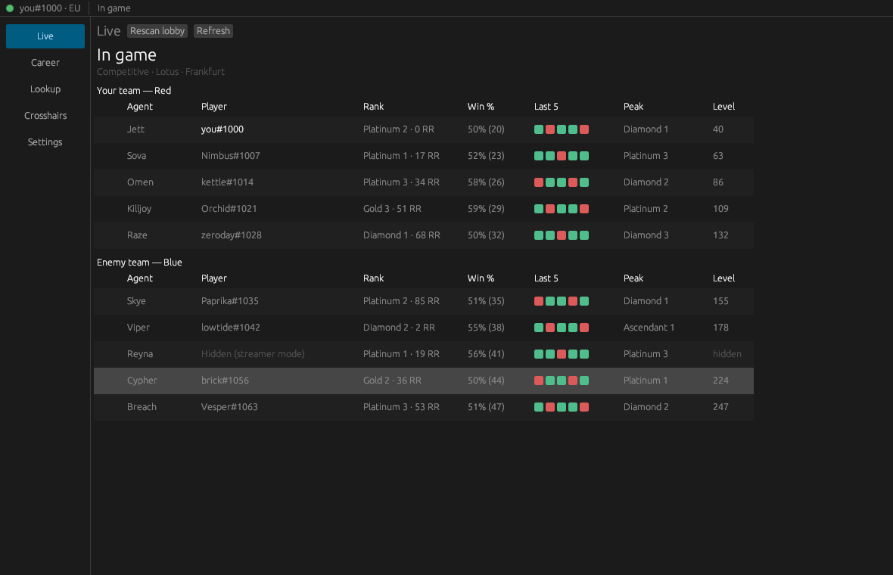

# Ascend-Lite

A lightweight, native desktop companion for VALORANT, written in Rust with
[egui](https://github.com/emilk/egui). No web view, no bundled browser.

- Detects the running Riot client and the signed-in player
- **Live:** game state (menus / agent select / in game) and a lobby roster with
  each player's rank, RR, season win rate, recent form, peak rank and level
- **Career:** your rank, an RR trend line, match history with K/D/A, ADR, HS%, ACS
- **Match detail:** both scoreboards (ACS, K/D, ADR, HS%, KAST, first kills/deaths,
  multi-kills, plants/defuses) and a round-by-round strip
- **Lookup:** another player's rank and recent matches
- **Crosshairs:** paste or build a crosshair code, preview it, save presets, copy



More: [career](docs/screenshots/career.png) · [match detail](docs/screenshots/match-detail.png) ·
[lookup](docs/screenshots/lookup.png) · [crosshairs](docs/screenshots/crosshairs.png) ·
[social](docs/screenshots/social.png). Screenshots are from `--demo` mode with synthetic
data; in normal use, agent, map and rank artwork from valorant-api.com shows next to each row.

## ⚠️ Disclaimer

**Ascend-Lite is an unofficial third-party tool. It is not affiliated with, endorsed,
sponsored or approved by Riot Games.** VALORANT and Riot Games are trademarks of
Riot Games, Inc. You use this app at your own risk and remain subject to Riot's
Terms of Service.

What the app does and does not do:

- It **only** uses the Riot Client's local API (the lockfile + `https://127.0.0.1:<port>`)
  and Riot's web endpoints (`pd.*.a.pvp.net`, `glz-*.a.pvp.net`), using the tokens the
  local client already issued. Artwork and static data come from
  [valorant-api.com](https://valorant-api.com).
- It **never** reads or writes game memory, never injects into, hooks or modifies any
  Riot process, has no driver or overlay code, and never automates gameplay or input.
- Your lockfile password and Riot tokens are kept **in memory only**: never logged
  (they're wrapped in a type that prints `***`, and a test fails if one ever reaches a
  log line), never written to disk, and only sent to Riot's own hosts.
- Players with streamer mode ("incognito") on are shown as *Hidden*: their names are
  never requested or displayed, and hidden account levels stay hidden.
- Polling is conservative: GLZ is polled every few seconds only during agent select /
  in game; in menus the app relies on the local presence websocket.

The same disclaimer is shown on first launch and on the Settings screen.

## Download (Windows)

Every push builds `ascend-lite.exe` with GitHub Actions (**Actions → Windows build →**
pick a run → **Artifacts → ascend-lite-windows-x64**). Pushing a version tag
(`git tag v0.1.0 && git push origin v0.1.0`) also publishes it as a GitHub Release.
The download also includes `mock-backend.exe`, which you only need to try the social
features offline. The exe isn't code-signed, so Windows SmartScreen may warn the first
time you run it.

## Build & run

Requires a stable Rust toolchain (2021 edition).

```sh
cargo run --release            # normal mode: start VALORANT, then the app
cargo run --release -- --demo  # synthetic data, no Riot client needed
cargo run --release -- --debug # more verbose logging (secrets are still never logged)
```

The target platform is **Windows** (where VALORANT runs). The app also builds and runs
on Linux/macOS (handy for development with `--demo`). On Linux you need the usual
X11/Wayland libraries egui uses (e.g. `libxkbcommon-x11`).

**The tracker (Phases 1–2) needs no backend at all.** Everything comes straight from the Riot client
and valorant-api.com.

### Player lookup

Riot exposes no public "name#tag → player" endpoint to client tokens, so lookups find
players you've already encountered: friends, recent teammates and opponents, and
anyone in your current lobby (clicking a player on the Live screen looks them up). To
search *any* Riot ID, set `RIOT_API_KEY` to your own key from the
[Riot Developer Portal](https://developer.riotgames.com/). It's read from the
environment only and never stored.

### Files

| What | Where |
| --- | --- |
| Settings (theme, polling, crosshair presets…) | `%APPDATA%\ascend-lite\ascend-lite\config\settings.json` |
| Icon & match cache, logs | `%LOCALAPPDATA%\ascend-lite\ascend-lite\cache\` |

Settings never contain credentials. Override with `ASCEND_CONFIG_DIR` / `ASCEND_CACHE_DIR`.

### Environment variables (development)

| Variable | Purpose |
| --- | --- |
| `ASCEND_LOCKFILE` | Use a different lockfile path |
| `ASCEND_CLIENT_VERSION` | Override the Riot client version header |
| `RIOT_API_KEY` | Optional: search any Riot ID via Riot's official account API |
| `ASCEND_OFFLINE_CONTENT` | Skip valorant-api.com (no artwork; used by tests) |

## Social features (optional backend)

Friends, presence, lobbies and DMs need an Ascend-compatible backend, and are **off
unless you set a backend URL** (Settings → Social). For local use there's an in-memory
mock that implements the whole contract, with three bot friends who answer DMs:

```sh
cargo run -p mock-backend                 # serves http://127.0.0.1:8787
cargo run -- --demo                       # then Settings → Backend URL → http://127.0.0.1:8787
```

In `--demo` mode the app signs in to a configured backend automatically.
`MOCK_MIN_VERSION=9.0.0 cargo run -p mock-backend` demonstrates the "update required" gate.

What is (and isn't) shared with the backend:

- Never: the lockfile password, Riot tokens or anything else from the Riot session.
  The backend client has no access to the Riot session at all.
- Your game state (menus / agent select / in game + queue) is shared with friends only
  while "Share my game status" is on (default on once you sign in).
- Party size and queue (never the party id or members) are shared only if you turn on
  "Share my party size and queue" (default off).
- The backend session token is kept in memory only, so you sign in again after a restart.
- Only `https://` backend URLs are accepted, plus `http://` for localhost.

The mock's `POST /api/auth/dev-login` is a development stand-in. A real deployment
would put a proper identity provider (OIDC/Supabase-style) behind the same bearer-JWT
contract.

## Feature flags

| Feature | Default | What |
| --- | --- | --- |
| `fake-riot` | off | **Tests only.** Lets `ASCEND_FAKE_RIOT_BASE=https://127.0.0.1:<port>` stand in for Riot's PD/GLZ hosts so the whole worker can be tested end to end. Never enable in release builds. |

## Tests & checks

```sh
cargo fmt --check
cargo clippy --all-targets --features fake-riot -- -D warnings
cargo test --features fake-riot
```

The test suite covers lockfile parsing, header construction, region/shard host
building (including the GLZ host regex), stat derivations (K/D, ADR, HS%, KAST%, ACS,
trades, clutches, multi-kills), crosshair code parsing and round-trips, presence-blob
decoding, a fake Riot client (self-signed TLS on loopback, basic auth, presence
websocket), and an end-to-end worker run (bootstrap → career → agent select → in-game
roster with ranks). That run also checks streamer-mode privacy, and that no secret ever
reaches the logs or the disk.

See [ARCHITECTURE.md](ARCHITECTURE.md) for how it fits together.
