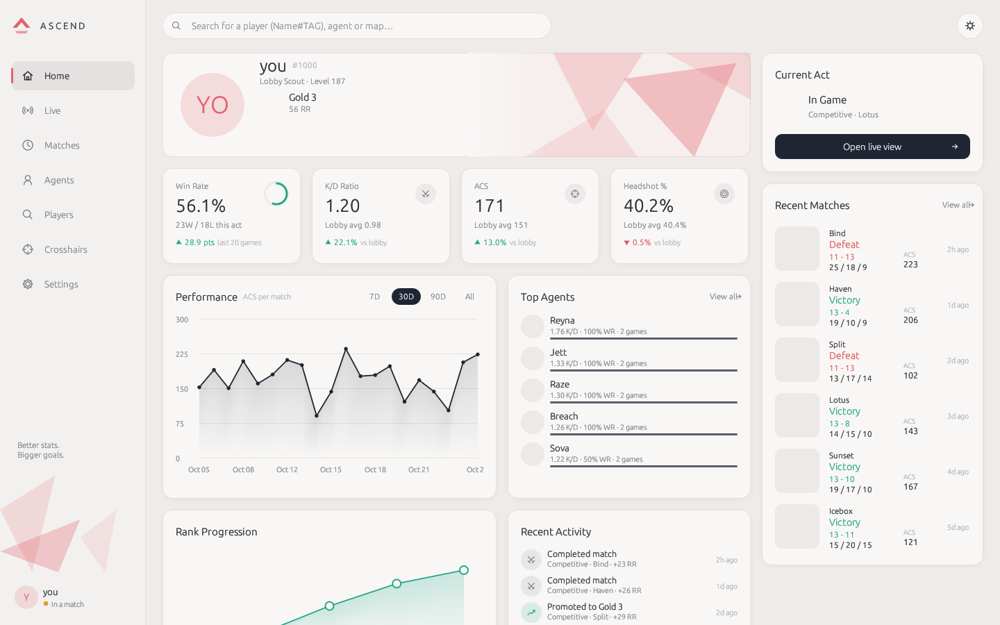

# Tracked

A lightweight, native desktop companion for VALORANT, written in Rust with
[egui](https://github.com/emilk/egui). No web view, no bundled browser.

- Detects the running Riot client and the signed-in player
- **Live:** game state (menus / agent select / in game) and a lobby roster with
  each player's rank, RR, season win rate, recent form, peak rank and level
- **Home:** your player card and rank; win rate, K/D, ACS and headshot % compared with
  the average player in your lobbies; an ACS chart (7D/30D/90D/All); top agents; rank
  progression; recent ranked activity; recent matches; and what you're doing right now
- **Matches / Agents:** full match history and per-agent stats (filterable from the search bar)
- **Match detail:** both scoreboards (ACS, K/D, ADR, HS%, KAST, first kills/deaths,
  multi-kills, plants/defuses) and a round-by-round strip
- **Lookup:** another player's rank and recent matches
- **2D replay:** watch any match top-down on the map's minimap, played like a video: all ten
  players move, kills flash in, the spike goes down and gets defused, with a scrubbable timeline,
  0.5×–4× speed, round chips and a live kill feed. Open it from the **Replays** tab, the
  **Replay** button on any match row, or the match screen
- **Crosshairs:** paste or build a crosshair code, preview it, save presets, copy
- **Social:** your Riot friends list with live status (in queue, agent select, in a match
  with the score, other Riot games), unread badges and whispers, all through the Riot
  Client's own chat. No account or backend needed
- **GPU rendering:** wgpu (Direct3D 12 / Vulkan), falling back to OpenGL automatically
- **Slim title bar:** the app draws its own minimal title bar (drag, double-click to maximize,
  edge resize). Settings → Window switches back to the system one



More: [home, lower half](docs/screenshots/home-bottom.png) · [dark mode](docs/screenshots/home-dark.png) ·
[agents](docs/screenshots/agents.png) · [live lobby](docs/screenshots/live.png) ·
[match detail](docs/screenshots/match-detail.png) · [startup check](docs/screenshots/startup.png) ·
[friends & whispers](docs/screenshots/friends.png) · [2D replay](docs/screenshots/replay.png) · [Replays tab](docs/screenshots/replays.png).
Screenshots are from `--demo` mode with synthetic data and no artwork; in normal use your
player card, agent, map and rank art load from valorant-api.com.

## ⚠️ Disclaimer

**Tracked is an unofficial third-party tool. It is not affiliated with, endorsed,
sponsored or approved by Riot Games.** VALORANT and Riot Games are trademarks of
Riot Games, Inc. You use this app at your own risk and remain subject to Riot's
Terms of Service.

What the app does and does not do:

- It **only** uses the Riot Client's local API (the lockfile + `https://127.0.0.1:<port>`)
  and Riot's web endpoints (`pd.*.a.pvp.net`, `glz-*.a.pvp.net`), using the tokens the
  local client already issued. Artwork and static data come from
  [valorant-api.com](https://valorant-api.com).
- It **never** reads or writes game memory, never injects into, hooks or modifies any
  Riot process, has no driver or overlay code, and never automates gameplay or input.
- Your lockfile password and Riot tokens are kept **in memory only**: never logged
  (they're wrapped in a type that prints `***`, and a test fails if one ever reaches a
  log line), never written to disk, and only sent to Riot's own hosts.
- Players with streamer mode ("incognito") on are shown as *Hidden*: their names are
  never requested or displayed, and hidden account levels stay hidden.
- Polling is conservative: GLZ is polled every few seconds only during agent select /
  in game; in menus the app relies on the local presence websocket.

The same disclaimer is shown on first launch and on the Settings screen.

## Download (Windows)

Every push builds `tracked.exe` with GitHub Actions (**Actions → Windows build →**
pick a run → **Artifacts → tracked-windows-x64**). Pushing a version tag
(`git tag v0.1.0 && git push origin v0.1.0`) also publishes it as a GitHub Release.
The download also includes `mock-backend.exe`, which you only need to try the social
features offline. The exe isn't code-signed, so Windows SmartScreen may warn the first
time you run it.

## Build & run

Requires a stable Rust toolchain (2021 edition).

```sh
cargo run --release            # normal mode: start VALORANT, then the app
cargo run --release -- --demo  # synthetic data, no Riot client needed
cargo run --release -- --debug # more verbose logging (secrets are still never logged)
cargo run --release -- --opengl # skip wgpu and use OpenGL (also in Settings → Renderer)
```

The target platform is **Windows** (where VALORANT runs). The app also builds and runs
on Linux/macOS (handy for development with `--demo`). On Linux you need the usual
X11/Wayland libraries egui uses (e.g. `libxkbcommon-x11`).

**The tracker (Phases 1–2) needs no backend at all.** Everything comes straight from the Riot client
and valorant-api.com.

### If it doesn't connect

The app opens on a **startup screen** that checks each part of the connection: the
Riot Client is running, you're signed in, region, game version, Riot ID, Riot's match
servers, and live updates. It moves on to the app once everything required passes.
When a step fails, the screen shows the actual error and what to try. **Copy
diagnostics** puts that checklist on your clipboard (no passwords or tokens) for a bug
report, and **Open logs folder** shows the log files. You can come back to the
checklist any time by clicking the status bar or the **Connection** tab.

`riot-probe.exe` (included in the download) checks the same connection from a console
window and prints each step: your Riot ID, a test call to Riot's servers, then live game
state as you go into agent select and a match. It prints no passwords or tokens, so you
can paste the output into a bug report.

### Player lookup

Riot exposes no public "name#tag → player" endpoint to client tokens, so lookups find
players you've already encountered: friends, recent teammates and opponents, and
anyone in your current lobby (clicking a player on the Live screen looks them up). To
search *any* Riot ID, set `RIOT_API_KEY` to your own key from the
[Riot Developer Portal](https://developer.riotgames.com/). It's read from the
environment only and never stored.

### Files

| What | Where |
| --- | --- |
| Settings (theme, polling, crosshair presets…) | `%APPDATA%\tracked\tracked\config\settings.json` |
| Icon & match cache, logs | `%LOCALAPPDATA%\tracked\tracked\cache\` |

Settings never contain credentials. Override with `TRACKED_CONFIG_DIR` / `TRACKED_CACHE_DIR`.

### Environment variables (development)

| Variable | Purpose |
| --- | --- |
| `TRACKED_LOCKFILE` | Use a different lockfile path |
| `TRACKED_CLIENT_VERSION` | Override the Riot client version header |
| `RIOT_API_KEY` | Optional: search any Riot ID via Riot's official account API |
| `TRACKED_OFFLINE_CONTENT` | Skip valorant-api.com (no artwork; used by tests) |

## 2D replay

The replay is rebuilt from the match-details data that every tracker uses
(`pd.<shard>/match-details/v1/matches/<id>`). Riot only records where players stood **at
each kill, plant and defuse**. Playback is smooth: between those moments each player glides
along a curve through their recorded positions. That in-between movement is an estimate
for viewing, not tracked data; at every kill, plant and defuse the positions are exact. It
is not VALORANT's own replay files (third parties can't access those).
Map images and calibration come from valorant-api.com; match data is cached on disk after
the first view. Deathmatch-style modes have no replay. To check it against your own matches:

```sh
riot-probe --replay            # your latest match: prints round 1's kills, writes replay-check.png
riot-probe --replay <matchId>  # a specific match
```

`replay-check.png` is the real minimap with valorant-api's named callouts (white), every
plant in the match (yellow) and the players at round 1's first kill. If the white dots sit in
their areas and the yellow ones on the sites, the coordinate transform is right.

## Riot friends & whispers (built in)

The **Social** tab shows your Riot friends and lets you whisper them. It talks only to the
Riot Client's local chat API on `127.0.0.1` (`/chat/v4/friends`, `/chat/v6/messages`, …) with the
same lockfile credentials as everything else. Nothing goes to any other server.

- Messages live in memory only. They are never logged or written to disk.
- Friend requests are shown read-only; accept or decline them in the Riot Client.
- No party invites or other in-game actions. The app reads state and sends whispers, nothing more.

## Tracked backend social (optional)


Friends, presence, lobbies and DMs need an Tracked-compatible backend, and are **off
unless you set a backend URL** (Settings → Social). For local use there's an in-memory
mock that implements the whole contract, with three bot friends who answer DMs:

```sh
cargo run -p mock-backend                 # serves http://127.0.0.1:8787
cargo run -- --demo                       # then Settings → Backend URL → http://127.0.0.1:8787
```

In `--demo` mode the app signs in to a configured backend automatically.
`MOCK_MIN_VERSION=9.0.0 cargo run -p mock-backend` demonstrates the "update required" gate.

What is (and isn't) shared with the backend:

- Never: the lockfile password, Riot tokens or anything else from the Riot session.
  The backend client has no access to the Riot session at all.
- Your game state (menus / agent select / in game + queue) is shared with friends only
  while "Share my game status" is on (default on once you sign in).
- Party size and queue (never the party id or members) are shared only if you turn on
  "Share my party size and queue" (default off).
- The backend session token is kept in memory only, so you sign in again after a restart.
- Only `https://` backend URLs are accepted, plus `http://` for localhost.

The mock's `POST /api/auth/dev-login` is a development stand-in. A real deployment
would put a proper identity provider (OIDC/Supabase-style) behind the same bearer-JWT
contract.

## Feature flags

| Feature | Default | What |
| --- | --- | --- |
| `fake-riot` | off | **Tests only.** Lets `TRACKED_FAKE_RIOT_BASE=https://127.0.0.1:<port>` stand in for Riot's PD/GLZ hosts so the whole worker can be tested end to end. Never enable in release builds. |

## Tests & checks

```sh
cargo fmt --check
cargo clippy --all-targets --features fake-riot -- -D warnings
cargo test --features fake-riot
```

The test suite covers lockfile parsing, header construction, region/shard host
building (including the GLZ host regex), stat derivations (K/D, ADR, HS%, KAST%, ACS,
trades, clutches, multi-kills), crosshair code parsing and round-trips, presence-blob
decoding, a fake Riot client (self-signed TLS on loopback, basic auth, presence
websocket), and an end-to-end worker run (bootstrap → career → agent select → in-game
roster with ranks). That run also checks streamer-mode privacy, and that no secret ever
reaches the logs or the disk.

See [ARCHITECTURE.md](ARCHITECTURE.md) for how it fits together.
